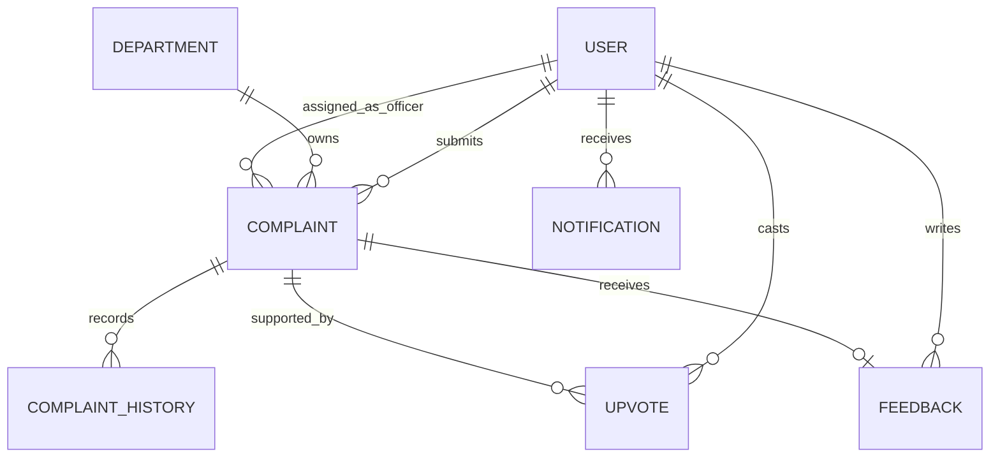
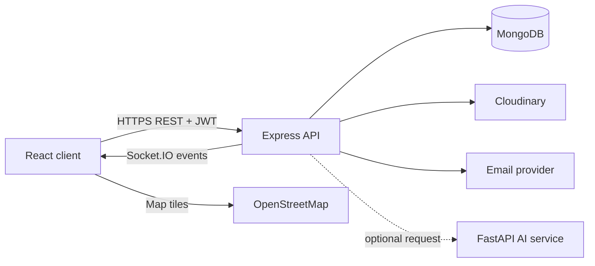

# CivicPulse architecture

## Phase plan

1. **Foundation:** Vite/React app, design tokens, responsive landing page, route shell.
2. **Identity and API:** Express server, MongoDB connection, User model, registration/login, JWT and role middleware.
3. **Citizen reports:** Complaint model and history, validated report form, upload service, tracking and upvotes.
4. **Operations:** Officer and administrator workflows, assignment rules, departments, permissions and audit history.
5. **Location:** GeoJSON complaint coordinates, geospatial queries, Leaflet map, nearby reports and filters.
6. **Analytics and notifications:** Database aggregations, CSV export, notification persistence, Socket.IO and email adapter.
7. **AI assistance:** Optional FastAPI classification, description and severity suggestions; duplicate candidate scoring; deterministic fallback.
8. **Hardening and delivery:** Integration tests, security review, deployment config, seed data and operational docs.

## Data model sketch

Complaint records will include a unique public reference, citizen and optional officer references, category, description, media URLs, GeoJSON point and address, severity, status, department, vote count, timestamps, and priority inputs. Every transition creates an immutable history entry. Compound indexes will support status/category/date filters; a `2dsphere` index will support nearby-report queries.

## Request and event flow

The client treats AI classifications as suggestions. The API validates authorization and all state transitions; officers can override AI suggestions. Statistics are computed from database records, and deployment secrets are supplied through environment variables.
